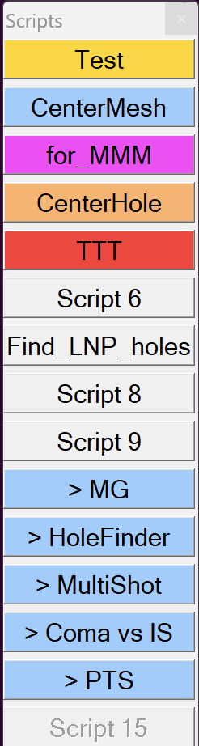

.. _colored_script_toolbar:

SerialEM Note: Colored Script ToolBar
=====================================
  
:Author: Chen Xu
:Contact: <chen.xu@umassmed.edu>
:Date_Created: Nov. 6, 2026
:Last_Updated: Nov. 6, 2026

.. glossary::

   Abstract
      Colored background and outline are now supported. It makes your
      SerialEM interface less boring. And more importantly, it can help to
      arrange your scripts more nicely, which increases the productivity.

      In this quick note, I show you how. 

The Colored ToolBar
-------------------

Below is a colored ToolBar.

**Fig.1 A Script ToolBar with Colored Filled Background**

..   :height: 361 px
..   :width: 833 px
   :scale: 50 %
   :alt: colored Toolbar
   :align: center

As you can see, I arranged a few scripts within the same category the same
background color. The color was controlled by a script command, as below.
One example is to launch a dialog quickly via script, i.e., bypassing menu
operation. 

.. code-block:: ruby

  ScriptName > HoleFinder
  # A script to open Hole Finder Dialog

  # color fill backfground
  ToolbarFillColor 153 204 255

  # Open dialog quickly
  OpenDialog HoleFinder

